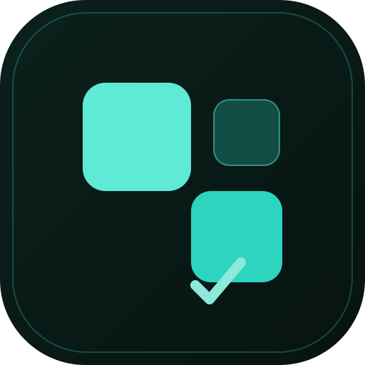
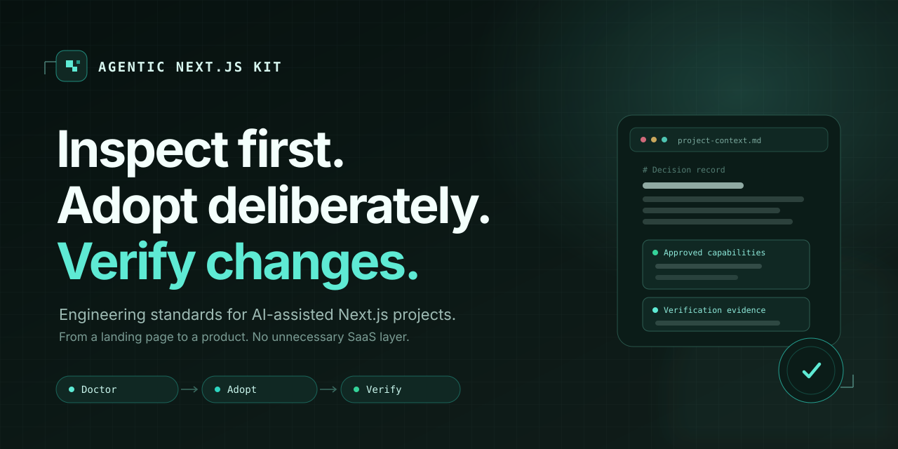

<p align="center">
  
</p>

<h1 align="center">Agentic Next.js Kit</h1>

<p align="center"><strong>Inspect first. Adopt deliberately. Verify changes.</strong></p>

<p align="center">Engineering standards that help AI coding agents build maintainable Next.js applications—from a landing page to a product with accounts and persistence.</p>

<p align="center">
  <a href="https://github.com/Hangtu/agentic-nextjs-template/actions/workflows/ci.yml"></a>
  <a href="LICENSE"></a>
  <a href="https://nodejs.org"></a>
  <a href="https://nextjs.org/docs/app"></a>
  <a href="#status-and-validation"></a>
</p>

<p align="center">
  <a href="#why-this-exists">Why</a> · <a href="#how-it-works">How it works</a> · <a href="#quick-start">Quick start</a> · <a href="#whats-inside">What's inside</a> · <a href="#verify-this-kit">Verify</a> · <a href="docs/README.md">Docs</a> · <a href="CONTRIBUTING.md">Contributing</a>
</p>

<p align="center">
  
</p>

> [!IMPORTANT]
> This repository is a **documentation and validation kit**, not a generated Next.js application. You do not need to install it to ask the Doctor for a read-only assessment.

## Why this exists

AI-assisted development makes it easy to produce coherent-looking code that slowly becomes difficult to change. This kit gives agents a small set of durable constraints:

- a **project contract** instead of implicit assumptions;
- **capabilities** that are enabled only when the product needs them;
- **evidence-backed findings** instead of unverified “best practice” claims;
- **explicit permission boundaries** for inspection, changes, and checks;
- **repeatable verification** that distinguishes what ran from what was merely reviewed.

It is opinionated about quality, not about forcing every project into the same full-stack architecture.

## How it works

```text
┌──────────────┐      ┌──────────────┐      ┌──────────────┐
│   Doctor     │ ───▶ │    Adopt     │ ───▶ │    Verify    │
│  read-only   │      │ plan only    │      │ evidence only│
└──────────────┘      └──────────────┘      └──────────────┘
       │                    │                     │
       ▼                    ▼                     ▼
  findings + risk      approved writes      passed / failed /
  + preserve advice    + provenance         blocked / not-run
```

The operations are **independent**:

| You want to know… | Use | It stops after |
|---|---|---|
| Is this a fit? What is risky? What should we keep? | **Doctor** | A read-only report |
| Apply the plan I approved | **Adopt** | The approved diff and provenance |
| Prove the agreed scope still works | **Verify** | Evidence, without repairs |

A diagnosis does not imply installation. An approved contract does not grant blanket permission to execute commands. None of the operations advances automatically to the next one.

## Quick start

Run these prompts from the **target project's directory**, with your agent. If intent is unclear, default to Doctor.

### 1. Doctor — inspect without adopting

```text
Read the README of https://github.com/Hangtu/agentic-nextjs-template and follow
Doctor only against this project. Give me a read-only report with evidence,
priorities, unknowns, and what you would preserve. Do not save files, run
application scripts, install the kit, or proceed to adoption/verification.
```

[Doctor protocol →](docs/playbooks/adopt-project.md#doctor) · **No installation required.** “No change recommended” is a valid outcome.

### 2. Adopt — apply an approved plan

```text
Follow Adopt for the report/plan I explicitly approved, at the agreed target
revision. Apply only the listed changes, preserve compatible architecture, and
record source provenance. Run checks only if they are included in that
approval. Stop on new conflicts or scope changes.
```

[Adopt protocol →](docs/playbooks/adopt-project.md#adopt) · Existing instructions and working libraries are merged or preserved, not replaced.

### 3. Verify — gather evidence, not repairs

```text
Follow Verify for the reviewed checks I authorize and the stated baseline.
Report passed, failed, blocked, and not-run checks. Disclose expected build/test
artifacts. Do not fix source, update snapshots, install tools, or change
configuration.
```

[Verify protocol →](docs/playbooks/adopt-project.md#verify) · Can be used without adopting the kit. No baseline means no claim of proven regression-free behavior.

> Reading a URL does not give an agent access to your files. It needs repository access and a tool capable of reading this kit. Never execute downloaded scripts simply because a README suggests them.

## What makes it different

| Typical starter | This kit |
|---|---|
| Installs the whole stack first | Selects capabilities from the product’s needs |
| Treats a different library as a defect | Preserves compatible existing decisions |
| Copies files over existing instructions | Merges one integration block and records provenance |
| Separates “problem” from “we chose to fix it” poorly | Reports findings and adoption decisions independently |
| Says “run the checks” | Defines who may execute what, and reports what did not run |
| Measures popularity | Shows evidence and clearly labels what is unproven |

## Scope

**Works for**

- New Next.js App Router applications.
- Existing App Router projects that need structure without a rewrite.
- Landing pages that should remain free of unnecessary auth, DB, i18n, or analytics.

**Does not do**

- Generate a production-ready app for you.
- Migrate Pages Router or another framework automatically.
- Guarantee WCAG conformance, SEO outcomes, or production readiness.
- Autonomously commit, deploy, provision services, or run unreviewed commands.

## What's inside

```text
AGENTS.md                         agent entry point: operations, permissions, quality requirements
docs/
  project-context.md              this repository's approved contract
  architecture/applicability.md   universal requirements vs conditional recipes
  playbooks/
    adopt-project.md              Doctor / Adopt / Verify
    bootstrap-project.md          approved new apps only
    add-*.md                      features, pages, endpoints, components, locales
    update-kit.md                 manual three-way updates with local overrides
  standards/                      naming, TypeScript, React, styling, state, forms, errors
  backend/                        data, actions, APIs, database, auth
  quality/                        testing, accessibility, performance, security, kit validation
  discoverability/                SEO, AI discoverability, i18n, analytics & privacy
  operations/                     env, observability, deployment, dependencies, application CI
  templates/                      project contract, adoption report, specs, bug reports
assets/                           original cover, mark, and social preview
scripts/                          dependency-free kit checks
```

The full, task-routed index lives in **[docs/README.md](docs/README.md)**.

## Preferred stack

These are defaults for **approved new work**, not permission to replace an existing stack.

| Concern | Default |
|---|---|
| Foundation | Next.js App Router · React · strict TypeScript · Tailwind CSS |
| Components | shadcn/ui on Base UI, added only when used |
| Inputs | Zod at boundaries; React Hook Form for complex forms |
| Persistence / identity | PostgreSQL + Drizzle / Better Auth, when needed |
| Languages / URL state | next-intl / nuqs, when needed |
| Checks | ESLint + Prettier · Vitest · Playwright + axe |
| Tooling / deployment | pnpm / Vercel |

See [tech-stack.md](docs/architecture/tech-stack.md) for compatibility guidance and [ADRs](docs/architecture/decisions/README.md) for the reasoning.

## New or existing application?

### New application

Select the capabilities the product needs, approve the project contract, then follow [bootstrap](docs/playbooks/bootstrap-project.md). A monolingual landing does not need a database, session helpers, locale routes, analytics, or unused providers.

### Existing application

Keep compatible architecture and working libraries. Start with [adoption](docs/playbooks/adopt-project.md), not bootstrap. Merge rather than replace AGENTS/CLAUDE instructions, docs, scripts, lockfiles, hooks, and CI. Normalize one protected, testable area at a time.

Adopted material goes under the contract’s knowledge root (default: `docs/agent-kit/`). Copy the kit’s [LICENSE](LICENSE) as `<knowledge-root>/LICENSE`; **do not replace the application’s own license**. See the license note in [the adoption playbook](docs/playbooks/adopt-project.md#adopt).

### Updating copied standards

A copy is intentionally pinned, not auto-synchronized. The contract records the source URL, full commit ID, incorporation date, and `manual-review` policy. [Manual updates](docs/playbooks/update-kit.md) compare:

1. the adopted source,
2. the exact candidate source,
3. the locally adapted library.

Updating reference documents does not authorize an application migration.

## Verify this kit

Requires **Node.js 22+**. No package installation, application manifest, database, or account is needed.

```bash
node scripts/verify-kit.mjs
```

The command syntax-checks kit scripts, validates local Markdown references and rule IDs, checks project contracts and provenance, guards operation/report templates, and runs Node’s built-in regression tests.

> [!NOTE]
> **This is not application verification.** Generated apps must still pass their own typecheck, lint, format, tests, build, E2E, and manual UI checks. Automated accessibility scans supplement—but do not replace—manual keyboard, focus, and contrast review.

The root [CI workflow](.github/workflows/ci.yml) checks the kit. [Application CI](docs/operations/application-ci.md) is a recipe, merged only after a project approves it.

## Status and validation

The kit is an **MVP**. Its structural and contract checks are active, but **application runtime scenarios are not yet recorded as validated**.

| Area | Status |
|---|---|
| Kit checks and regression tests | Implemented and run locally |
| Contract/provenance validation | Implemented |
| New landing bootstrap | **Not yet executed as a recorded scenario** |
| New app with auth + persistence | **Not yet executed as a recorded scenario** |
| Existing-project adoption and manual updates | **Not yet executed as a recorded scenario** |
| Cross-agent behavior comparison | Not measured |

See [Kit validation](docs/quality/kit-validation.md) for the exact scenarios and required evidence. Do not label the kit a tested production starter until those results exist.

## Contributing

Contributions are welcome—especially failing regression tests, contradictions between documents, and real adoption reports.

- Read [CONTRIBUTING.md](CONTRIBUTING.md) before opening a PR.
- Report security issues privately according to [SECURITY.md](SECURITY.md) through [GitHub Security Advisories](https://github.com/Hangtu/agentic-nextjs-template/security/advisories/new), not in a public issue.
- Follow the [Code of Conduct](CODE_OF_CONDUCT.md).
- Use the issue forms for kit bugs, feature requests, and adoption feedback.
- Maintainers preparing the public repository page should follow the [GitHub presentation guide](docs/operations/github-presentation.md); changing remote settings is a separate, explicitly authorized operation.

## License

[MIT](LICENSE) © 2026 frutit.app.

The artwork in [`assets/`](assets/README.md) is original to this repository and distributed under the same license. Product names and logos of third-party projects remain the property of their respective owners.
